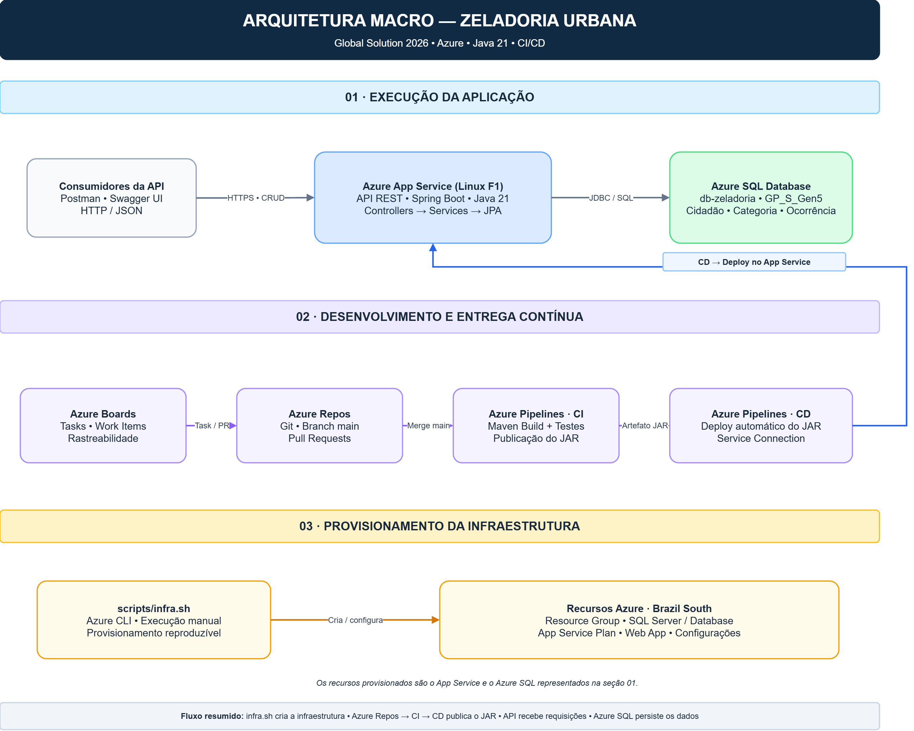

# Zeladoria Urbana — Global Solution 2026/2

API REST para cadastro e gerenciamento de ocorrências de zeladoria urbana, desenvolvida em **Java 21 e Spring Boot**, com persistência em **Azure SQL Database** e implantação no **Azure App Service** por meio do **Azure DevOps Pipelines**.

> **Projeto acadêmico — FIAP | Global Solution 2026/2**  
> Turma: **2TDSPF**  
> Integrante: **Cristian Alvaro Condori Paucara — RM550509**  
> Modalidade: **projeto individual**
> Link Video: **https://youtu.be/rOmYl124AT0**

## Sumário

- [Objetivo](#objetivo)
- [Arquitetura macro](#arquitetura-macro)
- [Tecnologias](#tecnologias)
- [Modelo de dados](#modelo-de-dados)
- [Endpoints REST](#endpoints-rest)
- [Execução local](#execução-local)
- [Infraestrutura Azure com CLI](#infraestrutura-azure-com-cli)
- [CI/CD no Azure DevOps](#cicd-no-azure-devops)
- [Testes e validação](#testes-e-validação)
- [Uso de IA generativa como apoio](#uso-de-ia-generativa-como-apoio)
- [Estrutura do repositório](#estrutura-do-repositório)
- [Links](#links)

## Objetivo

Disponibilizar uma API REST para registrar **cidadãos**, organizar **categorias** e gerenciar **ocorrências** relacionadas à zeladoria urbana. A solução demonstra desenvolvimento de backend, persistência relacional, provisionamento de infraestrutura em nuvem e automação de build, testes e deploy.

## Arquitetura macro



O desenho apresenta três fluxos complementares:

1. **Execução da aplicação:** clientes HTTP (Postman/Swagger) acessam a API Spring Boot hospedada no Azure App Service; a aplicação utiliza JPA para persistir dados no Azure SQL Database.
2. **Desenvolvimento e entrega contínua:** Azure Boards organiza o trabalho; Azure Repos versiona o código e utiliza branches e Pull Requests; Azure Pipelines executa o build, os testes e a publicação do JAR no App Service.
3. **Provisionamento:** o script `scripts/infra.sh`, executado manualmente no Azure Cloud Shell, cria e configura os recursos necessários. O provisionamento não é executado automaticamente pela pipeline.

## Tecnologias

| Camada | Tecnologia |
| --- | --- |
| Linguagem | Java 21 |
| Backend | Spring Boot 4.0.8, Spring Web MVC |
| Persistência | Spring Data JPA / Hibernate |
| Validação | Jakarta Bean Validation |
| Build | Maven / Maven Wrapper |
| Documentação e testes manuais | Swagger UI / OpenAPI, Postman |
| Banco local e testes | H2 em memória (`jdbc:h2:mem:zeladoria;DB_CLOSE_DELAY=-1`) |
| Banco em nuvem | Azure SQL Database (General Purpose Serverless), driver Microsoft JDBC para SQL Server |
| Hospedagem | Azure App Service (Linux F1, Java 21) |
| Provisionamento | Azure CLI e Bash |
| Gestão e entrega | Azure Boards, Azure Repos, Azure Pipelines |

## Modelo de dados

A aplicação utiliza três entidades:

| Entidade | Tabela | Campos principais |
| --- | --- | --- |
| Cidadão | `cidadao` | `id_cidadao`, `nome`, `email` |
| Categoria | `categoria` | `id_categoria`, `nome`, `descricao` |
| Ocorrência | `ocorrencia` | `id_ocorrencia`, `titulo`, `descricao`, `id_cidadao`, `id_categoria` |

Uma **ocorrência** está vinculada a um **cidadão** e a uma **categoria** por relacionamentos `ManyToOne`. As entidades utilizam validação de campos obrigatórios e limites de tamanho.

O arquivo [`scripts/script-bd.sql`](scripts/script-bd.sql) contém o script SQL de referência do projeto. Na aplicação, o Hibernate está configurado para atualizar o esquema por meio de `spring.jpa.hibernate.ddl-auto=update`. **Não execute o script SQL de exemplo sem revisar seus comandos de inserção/alteração/exclusão e os IDs usados**, especialmente em um banco já populado.

## Endpoints REST

**URL base em produção:** `https://app-zeladoria-rm550509.azurewebsites.net`

| Método | Endpoint | Operação |
| --- | --- | --- |
| `POST` | `/cidadaos` | Cadastrar cidadão |
| `GET` | `/cidadaos` | Listar cidadãos |
| `GET` | `/cidadaos/{id}` | Buscar cidadão por ID |
| `PUT` | `/cidadaos/{id}` | Atualizar cidadão |
| `DELETE` | `/cidadaos/{id}` | Excluir cidadão |
| `POST` | `/categorias` | Cadastrar categoria |
| `GET` | `/categorias` | Listar categorias |
| `GET` | `/categorias/{id}` | Buscar categoria por ID |
| `PUT` | `/categorias/{id}` | Atualizar categoria |
| `DELETE` | `/categorias/{id}` | Excluir categoria |
| `POST` | `/ocorrencias` | Cadastrar ocorrência |
| `GET` | `/ocorrencias` | Listar ocorrências |
| `GET` | `/ocorrencias/{id}` | Buscar ocorrência por ID |
| `PUT` | `/ocorrencias/{id}` | Atualizar ocorrência |
| `DELETE` | `/ocorrencias/{id}` | Excluir ocorrência |

### Exemplos de requisições JSON

**Cadastrar cidadão — `POST /cidadaos`**

```json
{
  "nome": "Maria Silva",
  "email": "maria.silva@example.com"
}
```

**Cadastrar categoria — `POST /categorias`**

```json
{
  "nome": "Iluminação pública",
  "descricao": "Problemas com postes e iluminação das vias"
}
```

**Cadastrar ocorrência — `POST /ocorrencias`**

> Utilize IDs de cidadão e categoria previamente cadastrados. O exemplo abaixo supõe que ambos receberam o ID `1`.

```json
{
  "titulo": "Poste apagado",
  "descricao": "Poste sem iluminação na rua principal",
  "cidadao": { "idCidadao": 1 },
  "categoria": { "idCategoria": 1 }
}
```

**Atualização:** use `PUT /{recurso}/{id}` com o JSON do recurso atualizado. **Exclusão:** use `DELETE /{recurso}/{id}`. Os controllers retornam `201 Created` para criação, `200 OK` para consultas/atualizações bem-sucedidas, `204 No Content` para exclusão e `404 Not Found` quando o ID não existe nas operações correspondentes.

Documentação interativa: [Swagger UI](https://app-zeladoria-rm550509.azurewebsites.net/swagger-ui/index.html).

## Execução local

**Pré-requisitos:** JDK 21 e Git. O projeto contém Maven Wrapper, dispensando a instalação global do Maven.

No Windows (PowerShell), a partir da raiz do repositório:

```powershell
.\mvnw.cmd clean test
.\mvnw.cmd spring-boot:run
```

No Linux/macOS:

```bash
./mvnw clean test
./mvnw spring-boot:run
```

Por padrão, o `application.properties` utiliza **H2 em memória**, com usuário `sa`, senha vazia e URL `jdbc:h2:mem:zeladoria;DB_CLOSE_DELAY=-1`. A aplicação atende em `http://localhost:8080`, e o Swagger UI fica em `http://localhost:8080/swagger-ui/index.html`.

### Configuração local e na nuvem

O mesmo `application.properties` funciona nos dois ambientes por meio de variáveis de ambiente:

```properties
spring.application.name=projeto
spring.docker.compose.enabled=false
spring.datasource.url=${SPRING_DATASOURCE_URL:jdbc:h2:mem:zeladoria;DB_CLOSE_DELAY=-1}
spring.datasource.username=${SPRING_DATASOURCE_USERNAME:sa}
spring.datasource.password=${SPRING_DATASOURCE_PASSWORD:}
spring.h2.console.enabled=${SPRING_H2_CONSOLE_ENABLED:true}
spring.jpa.hibernate.ddl-auto=${SPRING_JPA_HIBERNATE_DDL_AUTO:update}
spring.jpa.show-sql=false
spring.jpa.properties.hibernate.format_sql=true
server.port=${PORT:8080}
```

- **Local/CI:** sem variáveis de banco definidas, o projeto utiliza o H2 em memória. O console H2 está habilitado por padrão para desenvolvimento.
- **Azure:** o `scripts/infra.sh` configura `SPRING_DATASOURCE_URL`, `SPRING_DATASOURCE_USERNAME` e `SPRING_DATASOURCE_PASSWORD` no App Service para conectar ao banco `db-zeladoria`, e define `SPRING_H2_CONSOLE_ENABLED=false` e `SPRING_JPA_HIBERNATE_DDL_AUTO=update`.
- **Driver JDBC:** não é necessário definir `spring.datasource.driver-class-name`: o Spring Boot identifica o driver pela URL. O `pom.xml` contém as dependências `h2` e `mssql-jdbc`, ambas em escopo `runtime`.
- **Docker Compose:** a execução automática é desabilitada em `spring.docker.compose.enabled=false`; Docker não faz parte da implantação Azure deste projeto.

> **Segurança:** credenciais de produção são mantidas nas configurações do Azure App Service, não em arquivos versionados. Não publique senhas ou valores de variáveis sensíveis em commits, capturas de tela ou vídeos.

## Infraestrutura Azure com CLI

### Recursos provisionados

| Recurso | Nome / configuração |
| --- | --- |
| Assinatura | Azure for Students |
| Região | `brazilsouth` (Brazil South) |
| Resource Group | `rg-zeladoria-rm550509` |
| Azure SQL Server | `sql-zeladoria-rm550509` |
| Azure SQL Database | `db-zeladoria` — `GP_S_Gen5`, Serverless, 2 vCores |
| App Service Plan | `plan-zeladoria-rm550509` — Linux F1 |
| Web App | `app-zeladoria-rm550509` — Java 21 |

### Como provisionar

1. Entre no **Azure Cloud Shell**, selecione **Bash** e autentique-se na assinatura correta.
2. Disponibilize o arquivo `scripts/infra.sh` na sessão (por upload ou clone do repositório).
3. Execute, a partir da raiz do projeto:

```bash
chmod +x scripts/infra.sh
./scripts/infra.sh
```

4. Informe a senha do administrador `sqladmin` quando solicitada. **Não publique nem compartilhe a senha.**
5. Aguarde o resumo final dos recursos criados. O script configura a URL JDBC, as credenciais da aplicação e demais configurações do Spring Boot no App Service.

O script foi validado com **exclusão do Resource Group, recriação completa dos recursos e posterior publicação do JAR pela pipeline** em 19/11/2026.

**Observações importantes:**

- O script **não** realiza o deploy do JAR; essa responsabilidade é da pipeline.
- A opção de limite gratuito do Azure SQL depende da elegibilidade e disponibilidade da assinatura.
- A regra de firewall `AllowAzureServices` (`0.0.0.0`) permite acesso amplo a partir de serviços Azure e foi adotada para fins acadêmicos; em produção, utilize restrições de rede mais específicas.
- Caso o Resource Group seja excluído e recriado, a atribuição RBAC `Contributor` da identidade da Service Connection pode precisar ser restaurada antes de um novo deploy.
- O script é interativo e foi projetado para execução manual no Cloud Shell; não o inclua diretamente em uma pipeline não interativa sem adaptar o gerenciamento de segredos.

## CI/CD no Azure DevOps

**Organização:** `RM550509`  
**Projeto:** `GS2026-Zeladoria`  
**Repositório/pipeline:** `projeto`  
**Branch principal:** `main`  
**YAML:** [`azure-pipeline.yml`](azure-pipeline.yml)  
**Service Connection:** `sc-zeladoria-azure`

### Proteção da branch `main`

As políticas da branch `main` foram verificadas no Azure Repos:

| Política | Configuração |
| --- | --- |
| Número mínimo de revisores | **1**, obrigatório |
| Aprovação pelo autor da PR | Permitida para a simulação acadêmica |
| Work Item vinculado | **Required** (obrigatório) |
| Resolução de comentários | **Required** (obrigatória) |
| Revisor incluído automaticamente | **Cristian Alvaro Condori Paucara (RM550509)**, marcado como **Required** |

As alterações de desenvolvimento são realizadas em branches de trabalho e integradas à `main` por Pull Requests, associadas aos Work Items do Azure Boards.

### Fluxo de trabalho

1. Uma atividade é registrada no **Azure Boards**.
2. A alteração é desenvolvida em uma **branch** e vinculada ao Work Item.
3. Um **Pull Request** é aberto para a branch `main`, respeitando as políticas do repositório.
4. Após o merge, o **CI** compila o projeto com Maven e Java 21, executa os testes automatizados e publica o artefato JAR.
5. O **CD** utiliza a Service Connection para publicar o JAR no Azure App Service.
6. A API é validada por Swagger/Postman e consultas ao banco.

**Evidência de execução:** pipeline `#20261119.6`, executada após o provisionamento do ambiente, com **100% dos testes aprovados**, **1 artefato publicado** e etapa de **deploy concluída**.

> A execução `#20261119.6` foi iniciada **manualmente** para validar a infraestrutura recriada. No fluxo normal, o merge de uma Pull Request na `main` aciona a CI/CD automaticamente, conforme o YAML do projeto.

## Testes e validação

- **Testes automatizados:** executados pela pipeline Maven, com resultado aprovado na execução `#20261119.6`.
- **Swagger UI:** acessível no App Service após o deploy.
- **Postman:** operações CRUD testadas na aplicação publicada.
- **Persistência:** para evidência da entrega, apresente consultas `SELECT` diretamente no Azure SQL Query Editor, além dos resultados HTTP.

Exemplos de consultas SQL de verificação:

```sql
SELECT * FROM cidadao;
SELECT * FROM categoria;
SELECT * FROM ocorrencia;
```

> Os resultados dependem dos registros inseridos no ambiente. Para comprovar a persistência na apresentação, execute `SELECT` no **Azure SQL Query Editor** após as operações CRUD; respostas `GET` da API, isoladamente, não substituem essa evidência. Não exponha credenciais ou outros segredos em capturas de tela e gravações.

## Estrutura do repositório

```text
projeto/
├── docs/
│   └── arquitetura_macro_zeladoria.png
├── scripts/
│   ├── infra.sh
│   └── script-bd.sql
├── src/
│   ├── main/
│   │   ├── java/              # Controllers, Services, Repositories, Entities
│   │   └── resources/         # application.properties
│   └── test/                   # Testes automatizados
├── azure-pipeline.yml
├── pom.xml
├── mvnw
├── mvnw.cmd
└── README.md
```

## Links

- **API publicada:** https://app-zeladoria-rm550509.azurewebsites.net
- **Swagger UI:** https://app-zeladoria-rm550509.azurewebsites.net/swagger-ui/index.html
- **Azure DevOps:** https://dev.azure.com/RM550509/GS2026-Zeladoria
- **Pipeline:** https://dev.azure.com/RM550509/GS2026-Zeladoria/_build
- **Vídeo de apresentação:** **https://youtu.be/rOmYl124AT0**

---

**Global Solution 2026/2 — FIAP | Zeladoria Urbana**
